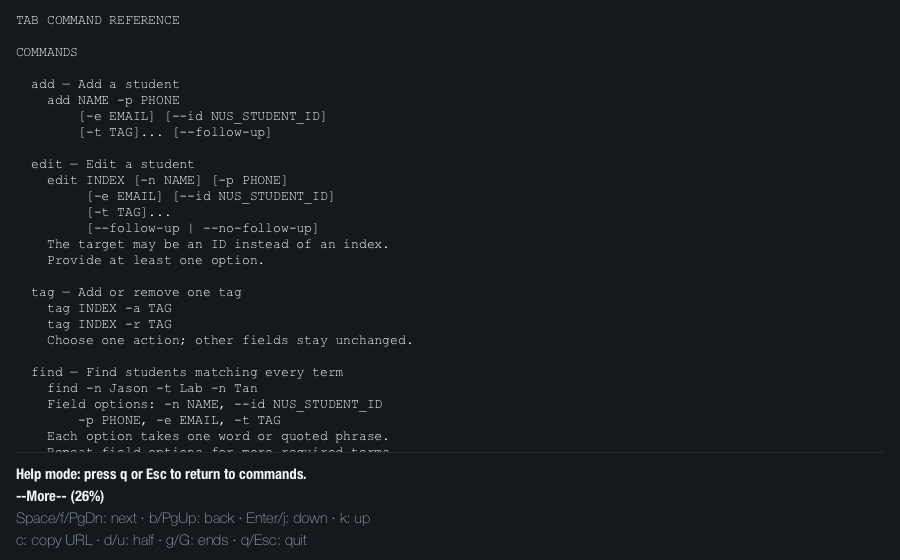
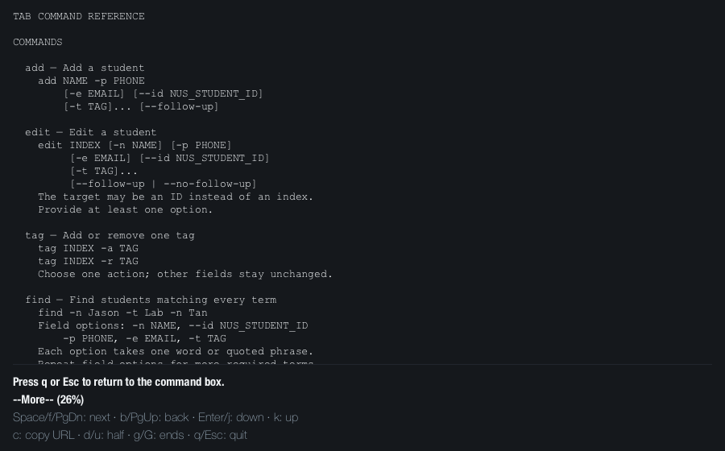
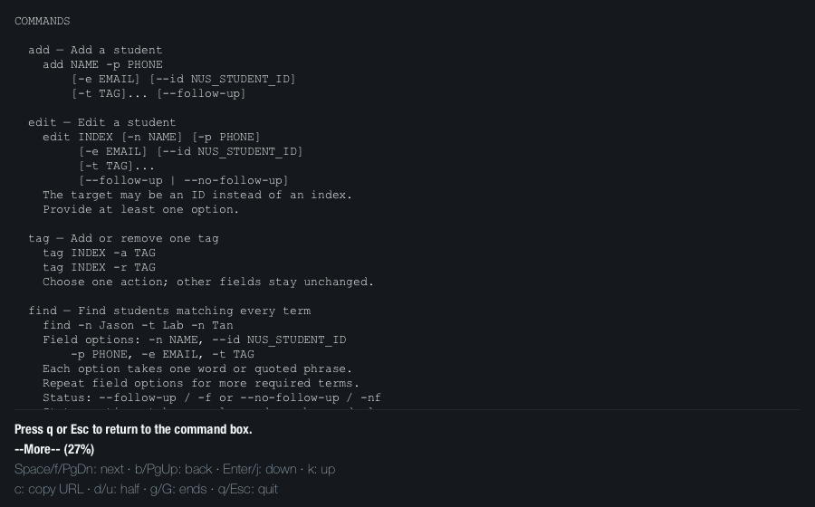
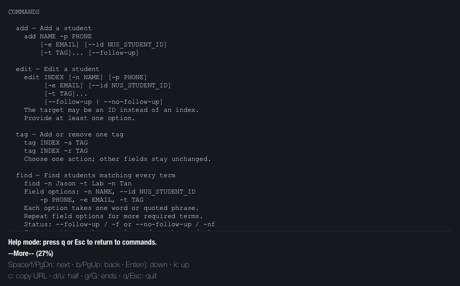

# Help notice evidence for issue #333

These images capture the actual JavaFX `HelpPage` at 900 × 560 pixels with
TAB's stylesheet and font selection. They were rendered offscreen on macOS
using the event sequences below. The notice text was not edited for the images.
These captures complement the manual macOS F1 verification recorded in PR #413;
they do not capture native keyboard input or the surrounding window frame.

The before view uses `HelpPage.java` from `510134af`, the PR's base revision.
The after view uses `HelpPage.java` from `ed7b05a0`, the reviewed PR head.
Both use the PR head's resources to keep the layout and reference text identical.

| Path | Replayed events | Before | After |
| --- | --- | --- | --- |
| Open with `help` | Show help, then deliver the submitting Enter's typed carriage return |  |  |
| Open with F1 | Show help, then deliver macOS F1's empty typed event |  |  |
| Navigate with Enter | Show help, press Down, then deliver Enter's pressed and typed events |  |  |

The rendering harness asserted the exact notice and reading position before
saving each image. Opening stays at the beginning. Down followed by Enter moves
two lines in both versions; only the notice changes with the fix.

For a manual check, open TAB and enter `help`. Read the footer, press Down and
Enter, and read it again. Press q and reopen with F1. The fixed version retains
`Help mode: press q or Esc to return to commands.` for all three paths.
