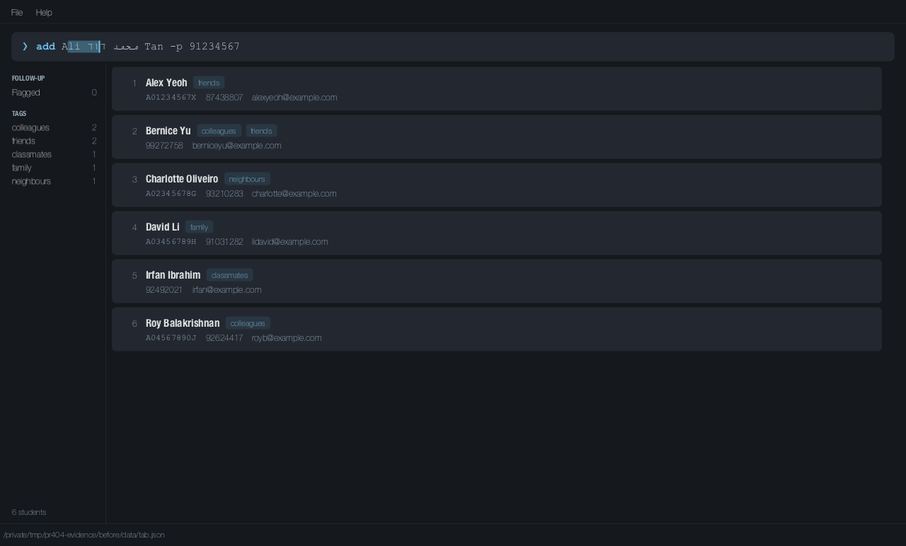

# PR #404 packaged-GUI validation

Validated on 23 October 2026. All 17 cases pass on the updated packaged JAR.
The baseline reproduces the Arabic/Hebrew caret and partial-selection defects.
The unquoted-name wrapping symptom does **not** reproduce on this machine;
the tested before and after commands both remain on one line.

## Environment and method

* macOS 26.5.1, OpenJDK 25.0.4, bundled JavaFX 17.0.7, default TAB theme/fonts.
* Before: `4329b174`, immediately before the first fix commit.
* After: `bfd31556`, the reviewed PR head. The follow-up changes only tests and
  this evidence, so its production code is identical to the captured JAR.
* Both JARs were built with `./gradlew shadowJar` and launched with `java -jar`
  in separate temporary directories, initially containing only their JAR.
  TAB creates its normal sample data and preferences there.
* An external verification agent drives the actual launched window's
  `TextFieldSkin`: hit testing plus `positionCaret` for clicks, `moveCaret`
  for Left/Right, `replaceText` for insertion, and `deleteChar` for Delete.
  The application classes and input handlers are not replaced. The launch form
  is `java -javaagent:<verification-agent>=<output-directory> -jar tab.jar`.
* Captures occur after JavaFX pulses settle. The command-pane PNGs below are
  direct JavaFX node snapshots from that window; the full-scene captures
  retain the surrounding application. At capture time the existing caret
  region is made visible and opaque so window focus and its blink phase do
  not conceal its geometry. Its position is never changed by the driver.
  Images are not redrawn, composited or retouched.
* These are automated rendered-GUI checks, not physical mouse/keyboard tests.
  No Windows/Linux visual verification is claimed.

The driver compares the copy's line height with native text, compares the
visible caret with the native primary caret, checks insertion/deletion text,
and compares selection coverage with the native selected glyph ranges. For
selection it compares horizontal coverage at each shape's own vertical center:
the native text and overlay can center different font line boxes. This corrects
an earlier test oracle that could compare points outside both shapes and miss
an incorrect selection. The strengthened check detects the baseline defects.

The commands and index ranges below document the interactions. The same
geometry checks are covered by `CommandBoxTest` in the normal test suite; the
packaged-JAR cases additionally exercise the launched window and its skin.

## Commands and interactions

The first seven cases use these commands without pressing Enter:

```text
add محمد علي حسن -p 91234567
add דוד כהן -p 91234567
add "محمد علي حسن" -p 91234567
add "דוד כהן" -p 91234567
add Ali محمد דוד Tan -p 91234567
add José Tan -p 91234567
add 陈伟明 李 -p 98123344
```

For caret checks, the driver clicks within `find -n محمد` and `find -n דוד`.
It inserts `Z` at the actual clicked insertion index in the Arabic case.
Selections use UTF-16 index ranges `[9,11)` in `find -n محمد علي`, `[9,10)`
in `find -n דוד כהן`, and `[5,10)` in the mixed-script add command. The last
range appears in two separate visual segments after the fix.

The scrolling command is `add ` followed by twelve copies of `محمد علي דוד כהן `
and `-p 91234567`. The driver moves to its end, selects `[length-26,length-19)`,
and narrows the window from 1280 to 800 pixels while the selection is active.
The last case uses Left and Right in `find -n محمد דוד`, verifies the caret,
and deletes at insertion index 10. The baseline fails the first caret check
in that final case, so it does not reach that case's Delete operation.

## Before and after captures

All images are captured from TAB itself for this PR. Open an image to inspect
it at full size. The result column describes the checks, independently of the
visible screenshots. Exact results are in [before/results.txt](before/results.txt)
and [after/results.txt](after/results.txt).

| Case | Before | After | Result |
| --- | --- | --- | --- |
| Unquoted Arabic name |  |  | Single line in both runs |
| Unquoted Hebrew name |  |  | Single line in both runs |
| Quoted Arabic name |  |  | Single line in both runs |
| Quoted Hebrew name |  |  | Single line in both runs |
| Latin, Arabic and Hebrew together |  |  | Single line in both runs |
| Latin/accented control |  |  | Passes in both runs |
| CJK control |  |  | Passes in both runs |
| Click inside Arabic word |  |  | Caret alignment fails before; passes after |
| Insert Z at the clicked index |  |  | Caret alignment fails before; passes after |
| Click inside Hebrew word |  |  | Caret alignment fails before; passes after |
| Partial Arabic selection |  |  | Glyph coverage fails before; passes after |
| Partial Hebrew selection |  |  | Glyph coverage fails before; passes after |
| Selection across Latin and RTL words |  |  | Glyph coverage fails before; passes after |
| Long Arabic/Hebrew command |  |  | Horizontal scrolling passes in both runs |
| Select part of the scrolled command |  |  | Glyph coverage fails before; passes after |
| Narrow the window with selection active |  |  | Caret alignment fails before; passes after |
| Left/Right movement and Delete |  |  | Caret alignment fails before; passes after |

## Full-window context

The same mixed-script selection, including the surrounding application:

Before:



After:


## JAR fingerprints

SHA-256 of the independently built JARs:

```text
Before: 7927b71a8dcaeaa713cb9acbd191e6763126ce77fdb6168a757fa5b7bc916100
After:  be2718c9fa2e7735b9730a6a1b0a2043daca16773b188f8b34e47c0fa8fba7fa
```
